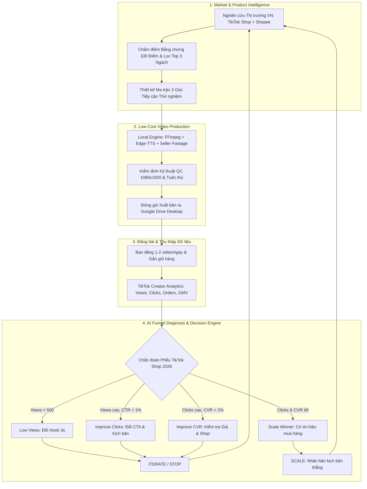

# Affiliate Agent Kit — AI Growth & Conversion System

> **Tư duy cốt lõi:** Không phải "AI Video Factory" sản xuất 100 video đại trà rồi chờ may rủi.  
> Đây là **AI Growth & Conversion System**: Video chỉ là công cụ; mục tiêu thực sự là tìm ra tổ hợp **Sản phẩm × Góc nội dung × Tệp khán giả** có khả năng tạo ra đơn hàng và lợi nhuận thực tế.

---

## 🎯 2 Chế độ Vận hành Theo Tình trạng Kênh

| Chế độ | Khi nào sử dụng? | Hành động của Hệ thống AI |
|---|---|---|
| **Exploration Mode** | Kênh mới (Giai đoạn A), chưa có dữ liệu lịch sử | Nghiên cứu thị trường sâu, chọn 3 ngách tiềm năng nhất, thử nghiệm có kiểm soát (6 video), chi phí sản xuất 0đ bằng footage thật & Local Engine |
| **Exploitation Mode** | Đã xuất hiện video có đơn hoặc tín hiệu tích cực | Kích hoạt bộ chẩn đoán phễu TikTok 2026, phân bổ tài nguyên để SCALE các kịch bản thắng, cắt bỏ (STOP) các sản phẩm thất bại |

---

## 💎 Định Vị Kênh: Chuyên Gia Giải Quyết Vấn Đề + Mua Sắm Thông Minh (A + C)

> **"Đừng xây kênh Affiliate. Hãy xây kênh có giá trị, rồi kiếm tiền bằng Affiliate."**  
> Người xem không bấm theo dõi kênh để xem quảng cáo. Họ theo dõi vì kênh giúp họ giải quyết vấn đề cuộc sống và tránh mua hớ.

### Chuỗi Ra Quyết Định Audience-First:
$$\text{Audience Intelligence} \to \text{Pain Discovery} \to \text{Content Strategy} \to \text{Solution Research} \to \text{Product Research} \to \text{Affiliate Match}$$

- **Quyền quyết định "KHÔNG BÁN HÀNG":** Nếu một vấn đề có thể giải quyết miễn phí (bằng cách sắp xếp, thói quen, mẹo 0 đồng), AI bắt buộc hướng dẫn giải pháp miễn phí và không gắn link giỏ hàng.
- **Phong cách thị giác:** **Faceless Educational Content** (Infographics chuyển động, hình ảnh bối cảnh Veo, sơ đồ 2D, không người mẫu giả review).

### Cơ Cấu Nội Dung 30 Video Đầu Tiên:
- **50% (15 video) — Giá trị thuần (0 bán hàng):** Mục tiêu: Lượt lưu (Saves), Lượt chia sẻ và Tỷ lệ chuyển đổi thành Follower.
- **30% (9 video) — Bóc tách sai lầm & So sánh khách quan:** Mục tiêu: Xây dựng uy tín chuyên gia (Chỉ ra 3 thứ phí tiền không nên mua, Kệ 30K vs Kệ 100K).
- **20% (6 video) — Giới thiệu giải pháp có gắn Affiliate:** Mục tiêu: Kiểm chứng chuyển đổi đơn hàng với sản phẩm chân ái đã qua kiểm định.

---

## 🏗 Kiến trúc Tăng trưởng Vòng lặp Khép kín (Closed-Loop Growth Architecture)



---

## 📁 Cấu trúc 8 Thư mục trên Google Drive Desktop

Toàn bộ tài nguyên được lưu tự động tại `G:\My Drive\Affiliate Factory\`:
```
Google Drive/
└── Affiliate Factory/
    ├── 01_Product_Research/       # Báo cáo thẩm định sản phẩm & phân tích điểm đau
    ├── 02_Approved_Assets/         # Ảnh chất lượng cao, âm thanh voiceover đã duyệt
    ├── 03_Scripts/                 # Kịch bản chi tiết 4 phân cảnh & badge tiêu đề
    ├── 04_Flow_Projects/           # Prompt Veo 3.1 tối ưu để dán vào Google Flow
    ├── 05_Raw_Videos/              # Video thô của seller hoặc clip Veo xuất từ Flow
    ├── 06_Rendered_Videos/         # Video các phân đoạn và video ghép hoàn chỉnh
    ├── 07_Quality_Reports/         # Báo cáo kỹ thuật (1080x1920, âm thanh, AIGC)
    └── 08_Ready_To_Post/           # ĐẦU RA CHO BẠN (Phân theo ngày & SKU)
        └── 2026-10-26/
            └── SKU-VACUUM-MINI-001/
                ├── video_final.mp4       # Video 9:16 dọc nét 100%
                ├── caption.txt           # Tiêu đề & hashtag chuẩn SEO
                ├── product_info.json     # Giá, hoa hồng, shop bán
                ├── quality_report.json   # Điểm số kiểm định QC (100/100)
                └── POST_INSTRUCTIONS.md  # Checklist đăng bài 1 phút
```

---

## 📊 Kết quả Sprint 1: Nghiên cứu Thị trường Việt Nam (Market Discovery)

Hệ thống đã phân tích định lượng **18 ngách thị trường** tại Việt Nam và chọn ra **Top 3 Ngách Chiến lược**:
1. **Phụ kiện điện thoại & Sạc nhanh** (87.5/100đ): Nhu cầu thiết yếu khổng lồ, quyết định mua nhanh, thông số Watt/GaN minh bạch, media kit chính hãng sắc nét.
2. **Đồ tiện ích & Vệ sinh xe ô tô** (87.0/100đ): Khách hàng ô tô chi tiêu cao, hoa hồng 12-20%, kịch bản giải cứu bụi bẩn / mùi hôi xe trực quan.
3. **Phụ kiện bàn làm việc & Công thái học** (86.5/100đ): Thị giác đẹp mắt, giải quyết nỗi đau gù lưng / mỏi cổ của dân văn phòng.

Toàn bộ 6 báo cáo & deliverables lưu tại [`docs/sprint1/`](docs/sprint1/):
- [`market_report.md`](docs/sprint1/market_report.md): Báo cáo toàn diện 18 ngách.
- [`niche_ranking.csv`](docs/sprint1/niche_ranking.csv): Bảng điểm 100 điểm chi tiết của từng ngách.
- [`product_candidates.csv`](docs/sprint1/product_candidates.csv): Danh mục sản phẩm đại diện có thể kiểm chứng.
- [`evidence_registry.json`](docs/sprint1/evidence_registry.json): Sổ đăng ký bằng chứng kiểm tra được (Zero-hallucination).
- [`research_gaps.md`](docs/sprint1/research_gaps.md): Minh bạch các dữ liệu `UNKNOWN` của kênh mới.
- [`video_test_plan.md`](docs/sprint1/video_test_plan.md): Kế hoạch sản xuất & thử nghiệm 6 video đầu tiên (2 video/ngách).

---

## 🚀 Hướng dẫn Sử dụng (CLI)

### 1. Xem xếp hạng 18 ngách thị trường
```bash
python cli.py view-niches
```

### 2. Xem hồ sơ chân dung khán giả & danh mục nỗi đau thực tế
```bash
python cli.py view-personas
```

### 3. Xem kế hoạch biên tập 30 video cân bằng (50% Giá trị, 30% Niềm tin, 20% Bán hàng)
```bash
python cli.py view-editorial-plan
```

### 4. Tính toán kinh tế đơn vị & xác suất ra đơn (Reverse Calculator)
```bash
python cli.py growth-calc --profit 5000000 --price 200000 --commission 0.10 --ctr 0.01 --cvr 0.03
```

### 5. Tạo ma trận 3 góc kịch bản thử nghiệm cho SKU
```bash
python cli.py plan-test --sku SKU-PHONE-GAN30W-001
```

### 6. Ghi nhận số liệu video thực tế & Chẩn đoán phễu TikTok 2026
```bash
python cli.py log-metrics --sku SKU-PHONE-GAN30W-001 --video-id VID-TIKTOK-01 --views 8500 --clicks 120 --orders 3 --commission 60000
```

### 7. Xem chẩn đoán phễu chi tiết & quyết định STOP / ITERATE / SCALE
```bash
python cli.py growth-diagnosis --sku SKU-PHONE-GAN30W-001
```

### 8. Xem tổng quan danh mục sản phẩm (Portfolio Overview)
```bash
python cli.py growth-portfolio
```

### 9. Chạy lại Sprint 1 Market Discovery bất cứ lúc nào
```bash
python cli.py sprint1-discover
```

---

## 🧪 Kiểm thử Tự động (Unit Tests)

Chạy toàn bộ 2 bộ kiểm thử hệ thống:
```bash
python -m unittest tests/test_engine.py
python -m unittest tests/test_growth_and_market.py
```
