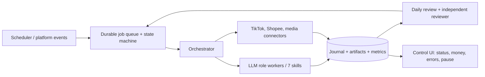

# Bộ điều khiển chạy nền cho affiliate agent

**Quyết định kiến trúc — 23/10/2026.** Mục tiêu là hệ thống tự chạy từng ngày, tiếp tục được sau lỗi hoặc khởi động lại, và để chủ tài khoản xem rõ agent đã quyết định, thực thi, xác minh và kiếm được bao nhiêu. Bảy skill hiện có là năng lực của từng vai; chúng chưa phải một dịch vụ chạy nền.

## Chọn hình dạng hệ thống

**Xây một controller chuyên cho affiliate, dùng Codex/LLM làm worker theo từng job.** Học từ Gateway, scheduler và phiên làm việc bền vững của [OpenClaw](https://docs.openclaw.ai/gateway), nhưng giữ luồng nghiệp vụ, tiền và quyền hành động trong database của mình. Không để một chat, Goal hoặc một LLM turn chạy vô hạn làm nơi lưu trạng thái chính.

### Thành phần MVP cho một developer

| Thành phần | Trách nhiệm |
|---|---|
| Một service chạy nền trên máy luôn bật hoặc VM | Khởi động cùng hệ điều hành; health check và tự khởi động lại khi process lỗi. Máy ngủ/tắt thì job đợi và được xử lý bù khi máy chạy lại. |
| SQLite ở chế độ WAL | Lưu `jobs`, `cycles`, `journal_events`, `artifacts`, `external_actions`, `source_syncs`, `daily_reviews`, `account_capabilities`. Một process điều phối và ít worker là đủ cho MVP; chỉ chuyển Postgres khi cần nhiều máy/worker. |
| Scheduler + queue | Tạo job theo lịch/ngữ cảnh; khóa job bằng lease; giới hạn thời gian; retry có backoff; job lỗi nhiều lần vào `NEEDS_ATTENTION`. Job key chứa account + ngày/công đoạn + phiên bản artifact để tránh tạo trùng. |
| Orchestrator | Đọc trạng thái bền vững, chọn vai tiếp theo, gọi skill/LLM với đầu vào có phiên bản, nhận artifact có schema, yêu cầu reviewer độc lập tại điểm giao. |
| Connectors | Mỗi năng lực (`read_products`, `read_analytics`, `publish_video`, `attach_product`, `read_commissions`, `spend_ads`) phải có trạng thái `VERIFIED`, `MANUAL`, `UNAVAILABLE`. Không tự suy rằng quyền đọc cho phép quyền đăng hoặc chi tiền. |
| Control UI | Hiển thị mode simulation/assisted/live, lần chạy và đồng bộ gần nhất, job đang chờ/lỗi, nhật ký, video, thử nghiệm, chi phí và hoa hồng pending/confirmed/paid; có nút pause, resume, retry, stop. |

## Vòng chạy bền vững

1. Scheduler đánh thức `discover`, `produce`, `publish`, `measure`, `daily_review` theo `next_due_at` và sự kiện thật. Mỗi job nhận đầu vào có `artifact_id/version` và ghi `started_at`, lease, attempt.
2. Worker hoàn thành một bước hữu hạn, ghi artifact và `JournalEvent` trước khi enqueue bước tiếp. LLM chỉ suy luận/biên tập trong bước đó; database quyết định job nào còn mở.
3. Trước khi lặp một hành động ngoài hệ thống như đăng video hoặc đổi ngân sách, connector **đọc lại trạng thái nền tảng** bằng idempotency key/external ID. Nếu trạng thái không xác định thì dừng ở `RECONCILE`, không bấm lại mù.
4. Khi service khởi động lại, quét lease hết hạn, đối soát các tác vụ ngoài hệ thống, và chạy bù review cho các ngày bị bỏ lỡ. Không đánh dấu `DONE` chỉ vì model đã nói xong.
5. Cuối mỗi ngày theo múi giờ tài khoản, đồng bộ nguồn rồi lập `DailyReview`. Reviewer độc lập kiểm tra phép tính, dữ liệu cũ và suy luận nhân quả. Ngày kế tiếp đọc review để chọn đúng một thử nghiệm tiếp theo.

Trạng thái tác vụ tối thiểu: `QUEUED → RUNNING → DONE`; nhánh `RETRY_WAIT`, `NEEDS_ATTENTION`, `RECONCILE`, `CANCELLED`. Trạng thái hành động nền tảng tách riêng: `PROPOSED → PREPARED → EXECUTED → VERIFIED`. Event journal chỉ ghi thêm; báo cáo là projection có thể tính lại.

## ChatGPT OAuth và đường dự phòng

[OpenAI Docs: Sign in with ChatGPT](https://developers.openai.com/siwc/token-sharing-open-source) hiện mô tả quyền dùng ChatGPT plan cho **ứng dụng open-source/tự host** đủ điều kiện. Quyền dùng model phải được người dùng cấp riêng với đăng nhập danh tính; client cần lưu host ID, bảo vệ refresh token và tự làm mới. Có cách cấu hình [Codex app-server dùng OAuth access token](https://developers.openai.com/siwc/token-sharing-open-source/codex-app-server): controller khởi chạy app-server, gửi các turn hữu hạn, lưu thread ID, và resume sau khi khởi động lại. Đây là lựa chọn chính **nếu tài khoản và loại ứng dụng được cấp quyền**; thử một inference thật để xác minh, không suy từ danh sách model.

OAuth không làm service chạy 24/7 và không cấp quyền TikTok/Shopee. [Giới hạn preview](https://developers.openai.com/siwc/token-sharing-open-source/preview-limitations) yêu cầu `store:false`, `stream:true`, không hỗ trợ Responses `background` hay hosted image generation/computer use/MCP trên đường này. Codex app-server vẫn hỗ trợ tool local theo tài liệu, nhưng video rendering và connector nền tảng phải là thành phần riêng. Khi 429/hết quyền, giữ job ở `RETRY_WAIT`/`NEEDS_ATTENTION` và báo trên UI; **không tự chuyển sang API tính tiền**. Với private app không đủ điều kiện OAuth, dùng OpenAI API key qua cùng `LLMProvider` interface sau khi chủ hệ thống thiết lập trần chi phí. [OpenAI Docs: điều kiện dùng plan](https://developers.openai.com/siwc/quickstart), [quản lý token và giới hạn](https://developers.openai.com/siwc/token-sharing-open-source/profiles-and-sessions).

Đường thử nhanh trên máy hiện tại là `codex exec`, gọi từng job hữu hạn từ controller; `codex login status` hiện báo CLI đã đăng nhập bằng ChatGPT, nhưng vẫn phải chạy một job thử để xác minh model, tool và quyền ghi. [Tài liệu Codex non-interactive](https://learn.chatgpt.com/docs/non-interactive-mode) xác nhận cách này dùng lại đăng nhập CLI. `codex exec` mặc định có giới hạn quyền ghi và thư mục projectless cần xử lý kiểm tra Git rõ ràng; không coi đăng nhập thành công là workflow đã chạy được. App-server + SIWC là đường **tích hợp tốt hơn cho sản phẩm riêng** sau khi thử quyền OAuth, refresh và các giới hạn preview. Cả hai dùng cùng queue/journal; thay LLM provider không thay dữ liệu kinh doanh.

## Quyền tự động theo giai đoạn

- **Simulation:** tìm sản phẩm, viết plan, dựng nháp, phân tích; hành động nền tảng chỉ được ghi giả lập.
- **Assisted:** tự chuẩn bị và đo; người dùng duyệt một số hành động đầu tiên để xác minh asset, link SKU và quyền tài khoản.
- **Live theo policy đã thiết lập:** tự đăng trong kênh/SKU/khung giờ đã cấp, nhưng connector vẫn đối soát URL, SKU, disclosure và trạng thái thật. Quảng cáo là quyền riêng có trần ngày/tổng và điều kiện dừng theo hoa hồng xác nhận; không suy quyền chi tiền từ quyền đăng.

Mục đích là giảm số lần phải hỏi người dùng khi chất lượng đã được chứng minh, đồng thời giữ nút dừng và khả năng truy vết từng hành động.

**Giới hạn xuất bản phải kiểm tra sớm:** [TikTok Content Posting API](https://developers.tiktok.com/docs/en/content-posting-api-get-started) cần app được duyệt và tài khoản cấp `video.publish`; client chưa audit chỉ đăng ở chế độ riêng tư. [Schema Direct Post](https://developers.tiktok.com/docs/en/content-posting-api-reference-direct-post) yêu cầu đồng ý rõ ràng cho metadata/video và không thể hiện trường gắn SKU affiliate. Do đó quyền đăng video thường **không chứng minh** quyền tự đăng video có gắn sản phẩm. TikTok Shop và Shopee Video phải được kiểm tra riêng trên tài khoản thật; nếu thiếu capability, hệ vẫn tự làm các bước còn lại và để `publish` ở `PREPARED` với handoff rõ ràng.

## Thứ tự xây để sớm có hệ thống thật

1. **Controller local + SQLite + journal + scheduler + UI tối giản**; chạy thử bằng connector giả lập, thử restart giữa job, job trùng và ngày bị bỏ lỡ.
2. **LLM provider + role workers:** trước tiên `codex exec` vì máy đã đăng nhập ChatGPT; sau đó thử SIWC/app-server bằng một turn thật và xác nhận quyền/model/refresh. Không đưa token vào journal.
3. **Nguồn dữ liệu và sản xuất:** kết nối nguồn sản phẩm/hoa hồng mà tài khoản thật cho phép, local video render, lưu asset và chi phí; bắt đầu ở simulation.
4. **Publish pilot:** chỉ bật connector khi đã xác minh đường đăng hợp lệ, quyền tài khoản, gắn SKU và đọc lại bài đã lên. Dùng assisted cho vài lượt đầu; sau đó mới cấp live policy.
5. **Daily learning thật:** chạy liên tục qua nhiều ngày, đối soát cohort 24 giờ và hoa hồng khi chốt; thử tắt process, hết OAuth, thiếu dữ liệu, đơn hoàn, upload không rõ trạng thái.

**Chưa có kết nối TikTok/Shopee hoặc OAuth SIWC được cấp trong dự án này.** Vì vậy tài liệu này xác định runtime cần xây và cách nghiệm thu, không gọi bộ skill hiện tại là một agent tự động đã chạy.

Phần chọn nguồn footage, tận dụng ChatGPT Plus và renderer được tách trong [quyết định sản xuất video](affiliate-video-production-decision.md).
